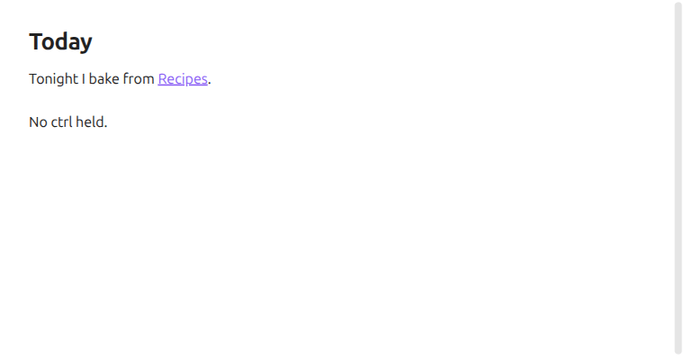

# Linger Preview

**Link previews without holding ctrl.**

Rest the pointer on a link for two seconds and its preview opens. Ctrl+hover still works, and moving off the link cancels the wait.

<picture><source media="(prefers-color-scheme: dark)" srcset="docs/linger-dark.gif"></picture>

It works wherever previews already work: the editor, reading view, the file explorer, search, backlinks, the graph, tab headers.

## Install

Copy `main.js` and `manifest.json` into `<vault>/.obsidian/plugins/linger-preview/`, or add this repo to [BRAT](https://github.com/TfTHacker/obsidian42-brat). The core Page preview plugin has to be on.

## Settings

How long the pointer rests before the preview opens. Two seconds by default.

How it works and the tests: [docs/usage.md](docs/usage.md).
